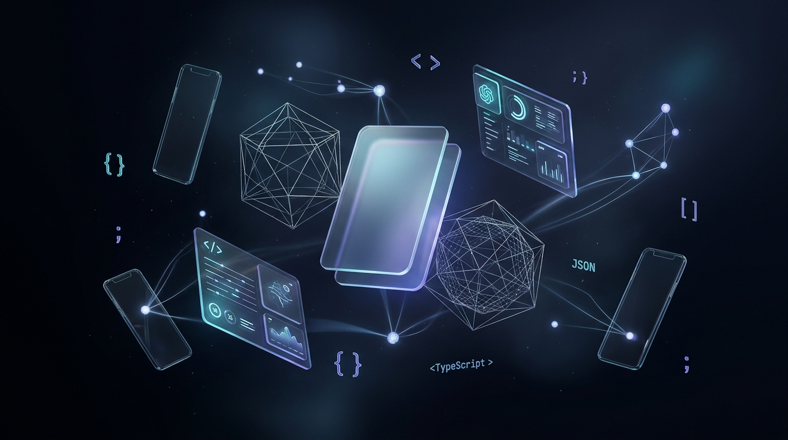
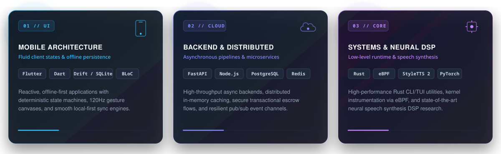

<!-- ========================================================================= -->
<!-- ⚡ HARDIK PREM | GITHUB PROFILE                                            -->
<!-- ========================================================================= -->

  <h1>HARDIK PREM</h1>

  <!-- Animated Dynamic Typing Headline -->
  

  

    <code>offline-first mobile architectures</code> &bull; <code>high-throughput backends</code> &bull; <code>kernel &amp; neural audio runtime</code>
  

  <!-- Clean Minimalist Action Badges -->
  

    
    &nbsp;
    
    &nbsp;
    
    &nbsp;
    
    &nbsp;
    
  

   

  <!-- 3D Spatial Glassmorphism Showcase Banner -->
  

<!-- ========================================================================= -->
<!-- 01 / ABOUT ME & DISCIPLINES                                               -->
<!-- ========================================================================= -->

## ✦ 01 // Overview & Coordinates

I’m **Hardik Prem**, a **B.Tech CSE (AI & ML) student at VIT Chennai**. I architect fluid cross-platform clients, engineer dependable asynchronous backends, and push performance boundaries with low-level systems tooling and neural speech DSP.

<table width="100%">
  <tr>
    <td width="50%" valign="top">
      <h3>⚡ Core Focus</h3>
      <ul>
        <li><b>📱 Mobile Architecture:</b> Reactive, offline-first Flutter development powered by Drift (SQLite) and clean state machines.</li>
        <li><b>☁️ Distributed Backends:</b> High-throughput async APIs using FastAPI, Node.js, PostgreSQL, and low-latency Redis caching.</li>
        <li><b>🦀 Systems &amp; Tooling:</b> Native Linux CLI/TUI tools in Rust (<code>portable-pty</code>, <code>ratatui</code>), GTK4 Wayland overlays, and kernel instrumentation.</li>
        <li><b>🎙️ Applied AI &amp; Speech DSP:</b> Neural speech synthesis pipelines with StyleTTS 2, custom G2P phonetic rules for Malayalam, and real-time YOLO inference.</li>
      </ul>
    </td>
    <td width="50%" valign="top">
      <h3>🧭 Coordinates &amp; Roles</h3>
      <ul>
        <li>🎓 <b>Education:</b> B.Tech in CSE (Specialization in AI &amp; ML) @ <b>VIT Chennai</b></li>
        <li>🚀 <b>GDG On Campus, VIT Chennai:</b> App Development Lead — conducting Flutter bootcamps and mentoring developers for <i>DevsHouse ’26</i>.</li>
        <li>💡 <b>Thanima Club:</b> Technical Lead — directing campus event platforms and internal mobile tooling.</li>
        <li>🤝 <b>Collaboration:</b> Open to mobile architecture, full-stack, and systems engineering opportunities.</li>
      </ul>
    </td>
  </tr>
</table>

 

  

<!-- ========================================================================= -->
<!-- 02 / FEATURED SYSTEMS & WORK                                              -->
<!-- ========================================================================= -->

## ◈ 02 // Featured Systems & Innovations

A curated index of engineered systems spanning production mobile apps, native utilities, and deep-tech prototypes.

<table width="100%">
  <tr>
    <td width="50%" valign="top">
      <h3>⚡ <a href="https://github.com/hardik1812/Onyx">Onyx &nbsp;·&nbsp; Hybrid Flutter + Rust Canvas</a></h3>
      

        
        
        
        
      

      

        A hybrid task manager and project canvas pairing Flutter's fluid UI with an embedded Rust engine. Features local Drift/SQLite persistence, Rust-based text classification, interactive slash commands (checklists, counters, timers), and a tactile, haptic-rich dark aesthetic.
      

      

        <a href="https://github.com/hardik1812/Onyx"><strong>Explore Repository ↗</strong></a>
      

    </td>
    <td width="50%" valign="top">
      <h3>🛠️ <a href="https://github.com/hardik1812/Error-hud">ErrorHUD &amp; KnobHUD &nbsp;·&nbsp; Native Tooling</a></h3>
      

        
        
        
        
      

      

        High-performance developer system utilities. Built in Rust utilizing <code>portable-pty</code> for pseudo-terminal multiplexing and real-time error log interception, combined with a high-refresh <code>ratatui</code> terminal interface and a GTK4 Wayland desktop overlay daemon.
      

      

        <a href="https://github.com/hardik1812/Error-hud"><strong>Explore Repository ↗</strong></a>
      

    </td>
  </tr>
  <tr>
    <td width="50%" valign="top">
      <h3>🔐 Safe-Swap &nbsp;·&nbsp; P2P Escrow Infrastructure</h3>
      

        
        
        
        
      

      

        Cross-platform mobile escrow engine ensuring safe peer-to-peer commerce. Connects a reactive Flutter client to Node.js microservices and Razorpay Route for automated payment authorization, state-machine verification, and multi-party settlement disbursements.
      

    </td>
    <td width="50%" valign="top">
      <h3>🎙️ Malayalam StyleTTS 2 &nbsp;·&nbsp; Neural Audio DSP</h3>
      

        
        
        
        
      

      

        Advanced neural speech synthesis research for Malayalam audio datasets. Designed custom grapheme-to-phoneme (G2P) phonetic parsing, acoustic loss optimization, and vocoder DSP pipelines to deliver expressive, human-like voice synthesis.
      

    </td>
  </tr>
  <tr>
    <td width="50%" valign="top">
      <h3>🌱 Smart Crop Digital Twin &nbsp;·&nbsp; Agritech IoT</h3>
      

        
        
        
        
      

      

        Cyber-physical agriculture twin coupling physical ESP32 environmental sensor telemetry with an async FastAPI server and the European WOFOST simulation model to calculate real-time soil hydration curves and predictive crop yield estimates.
      

    </td>
    <td width="50%" valign="top">
      <h3>👥 <a href="https://github.com/hardik1812/BreakBuddy">BreakBuddy &nbsp;·&nbsp; Campus Schedule Matcher</a></h3>
      

        
        
        
        
      

      

        A social utility app tailored for VIT Chennai students. Intelligently synchronizes academic timetables across friends to automatically detect overlapping free hours, helping students catch up and coordinate collaborative study sessions on campus.
      

      

        <a href="https://github.com/hardik1812/BreakBuddy"><strong>Explore Repository ↗</strong></a>
      

    </td>
  </tr>
  <tr>
    <td width="50%" valign="top">
      <h3>🤖 <a href="https://github.com/hardik1812/Ai-interview-sorter">AI Interview Sorter &nbsp;·&nbsp; Talent Pipeline</a></h3>
      

        
        
        
        
      

      

        Intelligent candidate screening assistant that parses developer resumes, benchmarks competencies against role requirements, and automates talent filtering to save recruiting teams hours of manual evaluation overhead.
      

      

        <a href="https://github.com/hardik1812/Ai-interview-sorter"><strong>Explore Repository ↗</strong></a>
      

    </td>
    <td width="50%" valign="top">
      <h3>🔬 eBPF Threat Engine &amp; YOLO Automation</h3>
      

        
        
        
        
      

      

        IEEE conference research proposal investigating kernel-level threat detection using lightweight eBPF hooks with accelerated inference, coupled with a real-time YOLO computer-vision automation pipeline for edge surveillance.
      

    </td>
  </tr>
</table>

  <a href="https://github.com/hardik1812?tab=repositories"><strong>Explore all public repositories on GitHub ↗</strong></a>

<!-- ========================================================================= -->
<!-- 03 / TECHNICAL ARSENAL                                                    -->
<!-- ========================================================================= -->

## ⬡ 03 // Technical Arsenal

A snapshot of languages, frameworks, cloud primitives, and developer tooling I use to architect and ship software.

<!-- Visual Skillicons Row -->

  

 

<table width="100%">
  <tr>
    <td width="26%"><strong>📱 Mobile &amp; Client</strong></td>
    <td>
      
      
      
      
      
      
    </td>
  </tr>
  <tr>
    <td><strong>⚙️ Backend &amp; Data</strong></td>
    <td>
      
      
      
      
      
    </td>
  </tr>
  <tr>
    <td><strong>🦀 Systems &amp; Hardware</strong></td>
    <td>
      
      
      
      
      
      
    </td>
  </tr>
  <tr>
    <td><strong>🧠 AI, Vision &amp; Audio</strong></td>
    <td>
      
      
      
      
      
      
    </td>
  </tr>
  <tr>
    <td><strong>🛠️ DevOps &amp; Tooling</strong></td>
    <td>
      
      
      
      
    </td>
  </tr>
</table>

<!-- ========================================================================= -->
<!-- 04 / GITHUB ACTIVITY & STREAK                                             -->
<!-- ========================================================================= -->

## ❖ 04 // Velocity & Consistency

  

<!-- ========================================================================= -->
<!-- 05 / LEADERSHIP & MILESTONES                                              -->
<!-- ========================================================================= -->

## ✦ 05 // Leadership & Milestones

<table width="100%">
  <tr>
    <td width="50%" valign="top">
      <h4>🚀 App Development Lead &nbsp;·&nbsp; GDG On Campus, VIT Chennai</h4>
      

        Spearheading mobile engineering initiatives, conducting hands-on Flutter workshops, mentoring student developers, and structuring developer tracks for <em>DevsHouse ’26</em>.
      

    </td>
    <td width="50%" valign="top">
      <h4>💡 Technical Lead &nbsp;·&nbsp; Thanima Club</h4>
      

        Directing full-stack web and mobile engineering for campus event infrastructure, ticketing portals, and internal student community tooling.
      

    </td>
  </tr>
  <tr>
    <td width="50%" valign="top">
      <h4>⚖️ Technical Judge &nbsp;·&nbsp; Gemma Hackathon (Aug 2026)</h4>
      

        Selected to evaluate artificial intelligence and machine learning software solutions leveraging Google Gemma open-weight models.
      

    </td>
    <td width="50%" valign="top">
      <h4>🎯 Qualifier &nbsp;·&nbsp; The Big Code 2026</h4>
      

        Advanced through competitive algorithmic and problem-solving rounds evaluated against nationwide engineering talent.
      

    </td>
  </tr>
  <tr>
    <td colspan="2" valign="top">
      <h4>🏆 Team Lead &nbsp;·&nbsp; Unicorn Hackathon</h4>
      

        Led an engineering team from conceptual system design to prototype deployment, orchestrating full-stack development and final executive pitch delivery.
      

    </td>
  </tr>
</table>

<!-- ========================================================================= -->
<!-- 06 / GET IN TOUCH / FOOTER                                                -->
<!-- ========================================================================= -->

  <h2>Let's Build Something Exceptional</h2>

  

    I’m always open to exploring ambitious mobile products, low-level systems challenges, or collaborative open-source tooling. 
    Have an interesting problem to solve or a high-impact role to discuss? <strong>Let’s connect!</strong>
  

  

    
    &nbsp;
    
    &nbsp;
    
    &nbsp;
    
  

   

  
    ⚡ Engineered with precision, tactile care &amp; passion &bull; &copy; 2026 Hardik Prem
  

