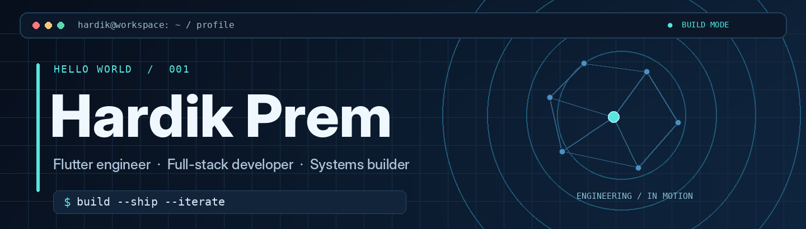
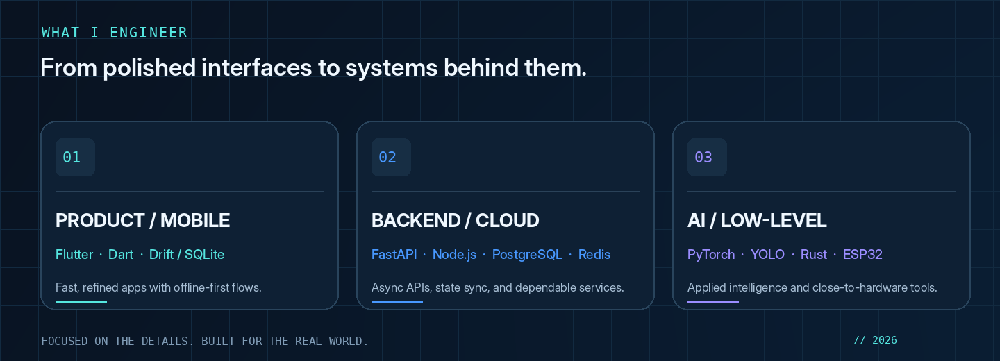

<!-- Portfolio-grade GitHub profile. All artwork is local: commit README.md and assets/ together. -->

  
  
<strong>Building thoughtful products. Engineering what happens beneath the surface.</strong>

  

    <a href="https://github.com/hardik1812">GitHub</a> &nbsp;•&nbsp;
    <a href="https://hardikprem.dev">Portfolio</a> &nbsp;•&nbsp;
    <a href="https://www.linkedin.com/in/hardik-prem-66a069266">LinkedIn</a> &nbsp;•&nbsp;
    <a href="mailto:hardikprem1234@gmail.com">Email</a>
  

---

## `01 /` Engineering

  

I’m **Hardik Prem**, a **B.Tech CSE (AI & ML) student at VIT Chennai**. I like building cross-platform apps, connecting them to reliable backends, and exploring the systems that make software fast, useful, and maintainable.

<table>
  <tr>
    <td width="50%" valign="top">
      <strong>⚡ What I focus on</strong>  
      <code>Mobile experiences</code> <code>Offline-first design</code> 
      <code>Backend architecture</code> <code>Applied ML</code> 
      <code>Developer tooling</code> <code>IoT systems</code>
    </td>
    <td width="50%" valign="top">
      <strong>↗ Where I contribute</strong>  
      App Development Lead — GDG On Campus, VIT Chennai 
      Technical Lead — Thanima Club 
      Freelance mobile & full-stack development
    </td>
  </tr>
</table>

## `02 /` Selected work

A few of the problem spaces I’ve been building in — from product engineering to AI and native utilities.

<table>
  <tr>
    <td width="50%" valign="top">
      <h3>🗓️ Dynamic Time-Blocking Scheduler</h3>
      Offline-first productivity app with algorithmic scheduling and gamified progression. Flutter and Drift (SQLite) on-device, with a FastAPI, PostgreSQL, and Redis backend for state sync.
        <code>Flutter</code> <code>Drift</code> <code>FastAPI</code> <code>Redis</code>
    </td>
    <td width="50%" valign="top">
      <h3>🔐 Safe-Swap — P2P Escrow</h3>
      Cross-platform escrow app connecting a Flutter client to Node.js services and Razorpay Route for peer-to-peer payment workflows and settlements.
        <code>Flutter</code> <code>Node.js</code> <code>Razorpay</code> <code>REST APIs</code>
    </td>
  </tr>
  <tr>
    <td width="50%" valign="top">
      <h3>🔊 Malayalam StyleTTS 2</h3>
      Neural speech synthesis work with Malayalam audio datasets, custom grapheme-to-phoneme processing, and audio DSP pipelines.
        <code>Python</code> <code>PyTorch</code> <code>StyleTTS 2</code>
    </td>
    <td width="50%" valign="top">
      <h3>🌱 Smart Crop Digital Twin</h3>
      ESP32 sensor telemetry integrated with an async FastAPI service, SQLite storage, and WOFOST crop simulation.
        <code>ESP32</code> <code>FastAPI</code> <code>SQLite</code> <code>WOFOST</code>
    </td>
  </tr>
  <tr>
    <td width="50%" valign="top">
      <h3>⌨️ ErrorHUD & KnobHUD</h3>
      Native utilities: a Rust terminal error tracker using <code>portable-pty</code> and <code>ratatui</code>, plus a GTK4 Wayland overlay daemon.
        <code>Rust</code> <code>Ratatui</code> <code>GTK4</code>
    </td>
    <td width="50%" valign="top">
      <h3>🧠 eBPF ML & Vision Automation</h3>
      An IEEE conference proposal exploring eBPF-based threat detection with accelerated inference, alongside a real-time YOLO computer-vision automation pipeline.
        <code>eBPF</code> <code>Python</code> <code>YOLO</code> <code>NPU / TPU</code>
    </td>
  </tr>
</table>

<a href="https://github.com/hardik1812?tab=repositories">Explore public repositories ↗</a>

## `03 /` The toolbox

| Layer | Technologies |
| :--- | :--- |
| **Mobile & web** | `Flutter` `Dart` `Drift` `SQLite` `JavaScript` |
| **Backend & data** | `FastAPI` `Node.js` `Firebase` `PostgreSQL` `MySQL` `Redis` `REST APIs` |
| **AI & research** | `Python` `PyTorch` `YOLO` `Audio DSP` |
| **Systems & hardware** | `Rust` `C` `C++` `eBPF` `ESP32` `GTK4` |
| **Dev tools** | `Git` `GitHub Actions` `Docker` `Linux` |

## `04 /` Leadership & milestones

- **App Development Lead — GDG On Campus, VIT Chennai:** Flutter workshops, student mentoring, and developer outreach for *DevsHouse ’26*.
- **Technical Lead — Thanima Club:** Web and mobile engineering for campus event tooling.
- **Technical Judge — Gemma Hackathon (Aug 2026):** Evaluated AI/ML and software projects.
- **The Big Code 2026:** Qualified through the online coding round.
- **Adobe University Hackathon 2026:** Led a student team developing a full-stack prototype.

---

  <h3>Have an interesting problem to solve?</h3>
  
I'm always interested in thoughtful apps, clever systems, and ambitious collaborations.

  
<a href="mailto:hardikprem1234@gmail.com"><strong>Let's build something →</strong></a>

  Designed to load reliably · No third-party image widgets · No vanity counters

